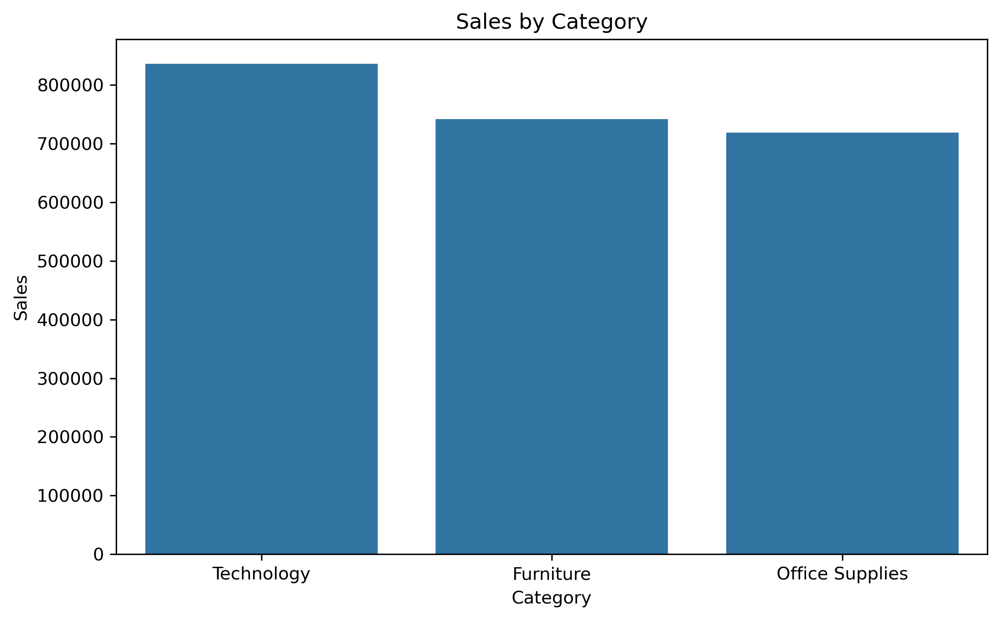
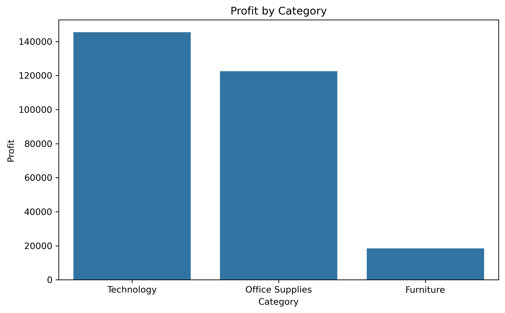
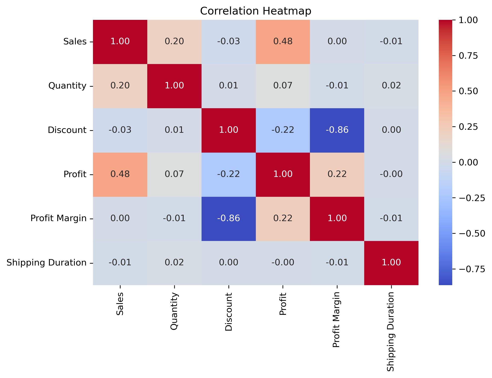

# 📊 Superstore Sales Analysis

## Project Overview

This project presents an exploratory data analysis (EDA) of the Superstore sales dataset using Python.

The analysis focuses on understanding sales performance, profitability, customer segments, regional performance, discount impact, and sales trends in order to extract useful business insights.

---

## 🛠 Tools & Technologies

- Python
- Pandas
- NumPy
- Matplotlib
- Seaborn
- Jupyter Notebook

---

## 🔍 Project Workflow

The project includes:

- Data inspection and validation
- Data cleaning
- Handling missing values
- Duplicate detection
- Feature engineering
- Outlier detection
- Exploratory Data Analysis (EDA)
- KPI calculation
- Sales and profit analysis
- Customer and product analysis
- Regional analysis
- Correlation analysis
- Monthly sales trend analysis
- Data visualization
- Business recommendations

---

## 📈 Key Findings

- Technology generated the highest overall sales and profit.
- Furniture achieved strong sales but showed a significantly lower profit margin.
- Higher discounts had a strong negative relationship with profit margin.
- The West region was one of the strongest-performing regions.
- The Consumer segment generated the largest share of sales.
- Sales showed noticeable seasonal patterns across different months.

---

## 💡 Business Recommendations

- Review products receiving high discounts with low profitability.
- Investigate low-profit products within the Furniture category.
- Focus marketing efforts on high-performing Technology products.
- Monitor loss-making products and customers.
- Use historical sales trends to improve inventory and campaign planning.

---

## 📊 Visualizations

### Sales by Category



### Profit by Category



### Correlation Heatmap



---

## 📁 Project Files

- `Superstore_Sales_Analysis.ipynb` — Complete analysis notebook
- `Sample - Superstore 2019.xls` — Original dataset
- `cleaned_superstore.csv` — Cleaned dataset
- `kpi_summary.csv` — Main KPI summary
- `sales_by_category.csv` — Sales summary by category
- `profit_by_category.csv` — Profit summary by category

---

## ▶️ How to Run

1. Clone or download this repository.
2. Install the required libraries:

```bash
pip install -r requirements.txt
