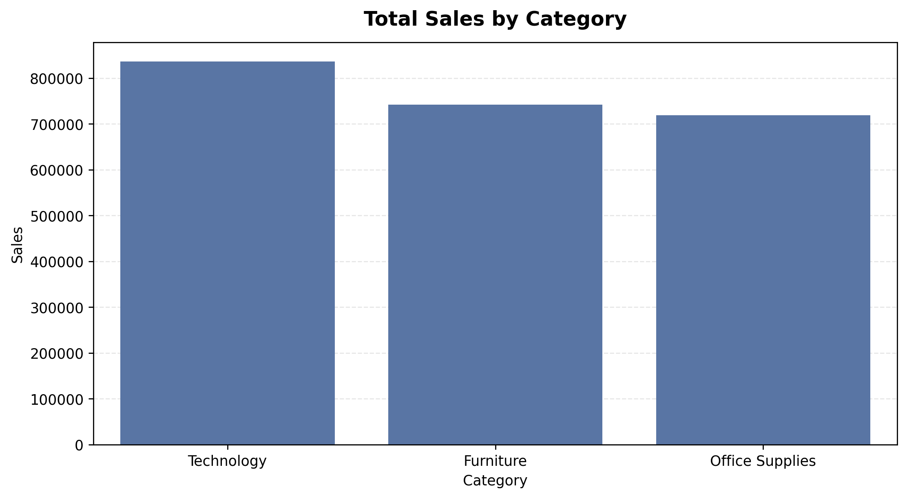
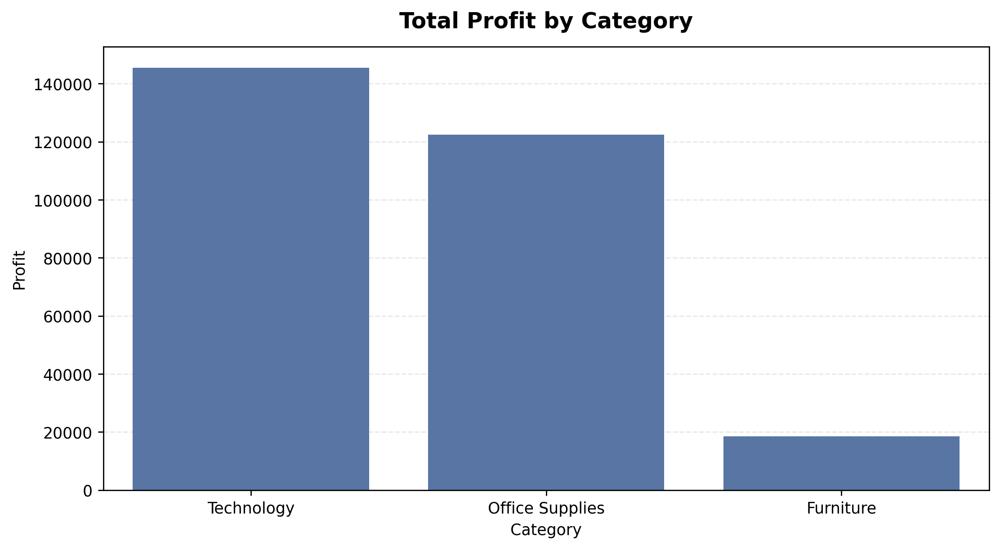
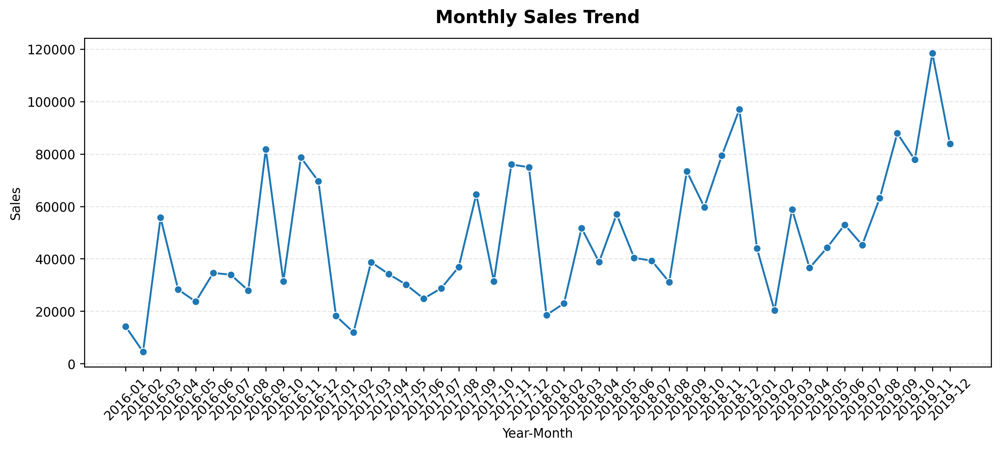
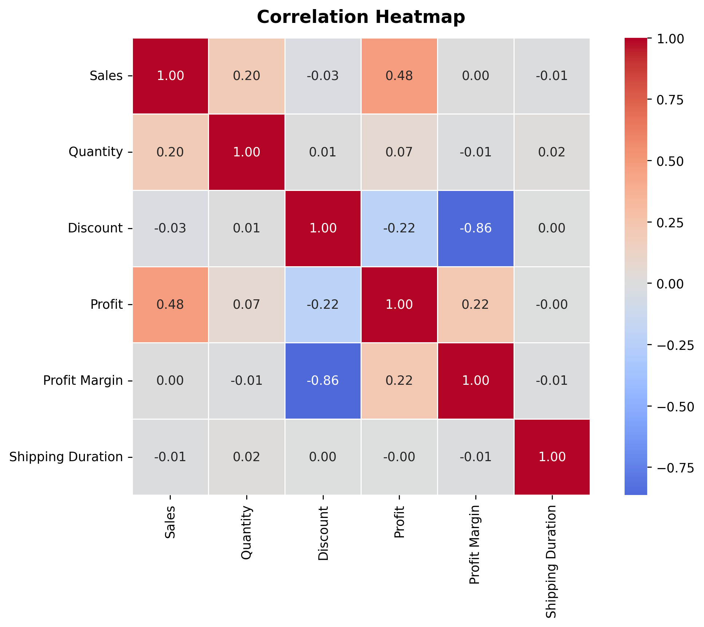

# Superstore Sales Analysis — Python

An end-to-end exploratory data analysis (EDA) project using Python, Pandas, NumPy, Matplotlib, and Seaborn to clean sales transactions, inspect data quality, analyze profitability and customer/product performance, and turn findings into business recommendations.

## Project highlights

- Audited missing values, duplicate rows, invalid numeric values, and date consistency.
- Cleaned postal codes without inventing missing source values; missing postal codes are labeled `Unknown`.
- Created derived features including profit margin, shipping duration, sales performance bands, and an outlier flag.
- Analyzed sales and profit by category, region, and customer segment.
- Reviewed top customers and products, shipping duration, monthly sales trends, and correlations.
- Exported the cleaned dataset, KPI summaries, analysis tables, and eight charts.

## Dataset snapshot

| Metric | Result |
|---|---:|
| Rows | 9,994 |
| Source columns | 21 |
| Total sales | $2,297,200.86 |
| Total profit | $286,397.02 |
| Orders | 5,009 |
| Customers | 793 |
| Units sold | 37,873 |
| Average shipping duration | 3.96 days |
| Overall profit margin | 12.47% |

Values are calculated from the included dataset. Amounts are rounded for display.

## Key findings

1. **Technology** leads total sales and profit by category.
2. **Furniture** has substantial sales but a much lower profit total than Technology and Office Supplies; review pricing, discounts, and product-level performance before making changes.
3. **West** is the strongest region by sales and profit in this dataset.
4. **Consumer** is the largest customer segment by sales.
5. The correlation analysis shows a strong negative relationship between discount and row-level profit margin. Correlation is not proof of causation, so discount policy should be reviewed with additional context.
6. Monthly sales vary across the year, with stronger periods toward year-end; this can inform further inventory and campaign planning.

## Visualizations

### Sales by category


### Profit by category


### Monthly sales trend


### Correlation heatmap


More charts are available in the `outputs/` folder.

## How to run

Use Python 3.10 or later.

### 1. Create a virtual environment

```bash
python -m venv .venv
```

### 2. Activate the virtual environment

**Windows (PowerShell):**

```powershell
.venv\Scripts\Activate.ps1
```

**macOS / Linux:**

```bash
source .venv/bin/activate
```

Use only the activation command for your operating system.

### 3. Install dependencies

```bash
python -m pip install -r requirements.txt
```

### 4. Run the notebook

```bash
jupyter notebook Superstore_Sales_Analysis.ipynb
```

Run the notebook from the project root directory so that the relative paths to `data/` and `outputs/` resolve correctly.

The notebook reads the included Excel dataset using `openpyxl` and regenerates the output CSV files and visualizations.
## Repository structure

```text
superstore-sales-analysis/
├── Superstore_Sales_Analysis.ipynb
├── README.md
├── DATA_DICTIONARY.md
├── requirements.txt
├── .gitignore
├── data/
│   └── superstore_2019.xlsx
└── outputs/
    ├── cleaned_superstore.csv
    ├── kpi_summary.csv
    ├── analysis summary CSVs
    └── eight PNG charts
```

## Tools

Python, Pandas, NumPy, Matplotlib, Seaborn, Jupyter Notebook, and Excel (`.xlsx`).
